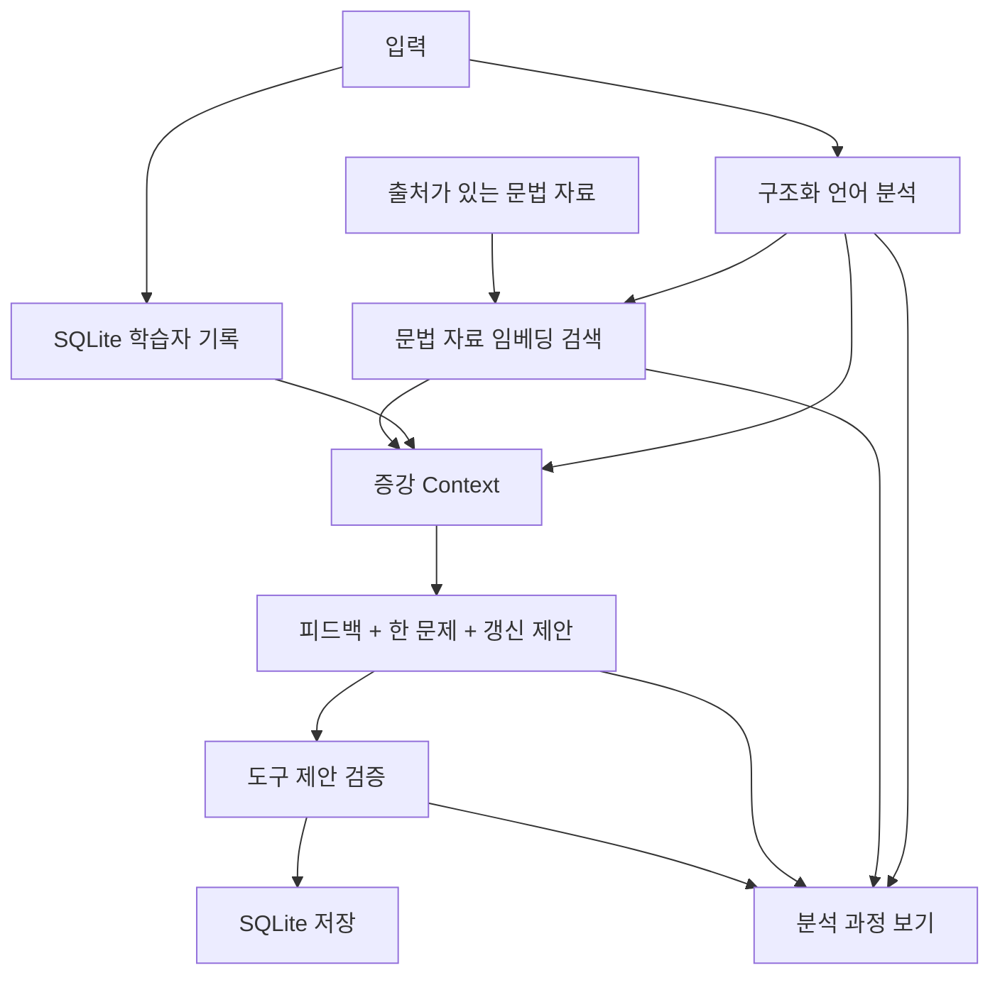

# Kontext — 한국어 문장 튜터

Kontext는 **LLM.zip | 압축 해제 — Chapter 7 Final**용 한국어 학습 데모입니다. 한 문장을 입력하면 학습 기록 조회 → 구조화 분석 → 문법 자료 검색 → 맞춤 피드백 → 연습문제 → 기록 갱신 순서로 실행됩니다. 모바일 웹의 문장 연습 화면에서 피드백과 연습문제를 바로 보고, 학습 기록은 별도 탭에서 확인합니다.

## Project Overview

```text
한국어 발화 → LLM 분석 ─┬→ 학습자 기록(SQLite) ─┐
                      └→ 문법 자료 검색(RAG) ──┤
                                             ↓
                                   맞춤 피드백 + 연습문제
                                             ↓
                                   검증된 기록만 DB 갱신
```

화면의 `분석 과정 보기`에서 각 단계의 입력과 출력, 검색 유사도, 소요 시간, 도구 제안과 결과를 볼 수 있습니다. 입문자가 흐름을 따라갈 수 있도록 LangChain, 별도 Vector DB, 프런트엔드 빌드 도구는 사용하지 않았습니다.

## Why This Project?

LLM 모델의 문장 생성만으로는 지난 학습 기록, 검증 가능한 외부 문법 자료, DB 갱신을 관리할 수 없습니다. 이 앱은 **모델**과 그 주변의 **시스템**이 어떻게 연결되는지 보여줍니다.

## Demo

`틀린 문장` 또는 `일상 문장` 버튼으로 예시 발화를 불러올 수 있습니다. 각 브라우저에는 임의의 데모 학습자 ID가 생기며 연결어미 3건, 조사 2건의 과거 기록이 준비됩니다. 모델은 학습자의 문장을 문맥에 따라 판단하도록 지시받습니다. 결과를 고정해 보여주지 않습니다.

다른 입력 예시: `어제 책이 읽었어요.` → 문맥상 `책을` 제안 → `을/를` 근거 표시 → 조사 연습문제 → 검증된 경우 학습 기록 갱신. 이는 설명용 예상 흐름이며 실제 모델의 판단과 문구는 달라질 수 있습니다.

## System Architecture



## LLM Core vs System Layer

- **LLM Core:** 언어 → 토큰 → 모델 내부 임베딩 → Transformer → 생성
- **System Layer:** 학습자 상태 → 외부 지식 검색 → 증강 Context → 구조화 출력 → 도구 검증 → DB 저장

모델 내부의 **토큰 임베딩**과 문법 문서 검색용 **검색 임베딩**은 서로 다릅니다. 이 앱은 모델 내부 벡터를 읽지 않습니다.

## End-to-End Pipeline

1. 빈 입력과 길이를 검사하고 기존 학습 기록을 조회합니다.
2. Gemini API의 JSON Schema 출력으로 `LanguageAnalysis`를 받습니다.
3. 오류 후보에 해당하는 문법 문서를 임베딩과 cosine similarity로 검색합니다.
4. 발화, 분석, 학습 기록, 검색 결과를 하나의 Context로 만듭니다.
5. 교정할 표현이 있으면 피드백, 객관식 문제 1개, 기록 갱신 **제안**을 한 번의 모델 호출로 받습니다.
6. 앱이 제안의 내용과 검색 근거를 검증한 뒤 SQLite에 기록합니다.
7. 실행 기록을 `분석 과정 보기`에 보여줍니다.

순서가 정해진 **Workflow**입니다. Agent가 다음 행동을 자율 선택하는 구조는 넣지 않았습니다.

## RAG

`data/grammar.json`의 24개 문법 요약은 국립국어원 한국어기초사전 항목을 근거로 직접 편집했습니다. 문단을 청크로 나누고 `gemini-embedding-2`로 벡터화한 뒤, 같은 범주의 문서에서 유사도 상위 결과를 찾습니다. 작은 자료집이므로 인메모리 검색을 사용합니다. 다루는 범주는 조사·연결어미·시제·기초 문법·높임/문체이며, 같은 범주의 검색 결과가 있어도 그 문장에 적합한 근거임을 보장하지 않습니다. 첫 검색에서 해당 문법 범주의 문서와 질의를 한 번에 임베딩하고, 문서 벡터는 서버 프로세스에서 재사용합니다.

**RAG ≠ Vector DB.** RAG는 외부 지식을 검색해 생성 Context에 넣는 과정입니다. 화면의 유사도는 검색 순위용 값이지 문법 판단의 참·거짓 확률이 아닙니다. 원문 출처 링크와 라이선스 설명은 [data/README.md](data/README.md)를 참고하세요. 공개 말뭉치의 문장을 복제하지 않았고, 평가 문장은 직접 작성했습니다.

## Personalization

SQLite의 `learners`, `error_history`를 Repository 계층에서 읽고 씁니다. 최근 20건의 오류 범주별 횟수를 Context에 넣습니다. 모국어만 보고 전이 오류를 추정하지 않습니다. 반복 패턴은 현재 요청 **이전** 기록이 2건 이상일 때만 언급하도록 지시합니다.

## Structured Output

`LanguageAnalysis`, `FeedbackOutput`, `PracticeSet`을 Pydantic으로 검증합니다. 분석 결과는 문법 오류, 문맥상 덜 자연스러움, 허용 가능한 표현, 판단 보류를 구분합니다. 모델의 `confidence`는 모델 추정치이며 정답 확률이 아닙니다. 앱은 원문에 없는 표현, 없는 근거 ID, 분석과 맞지 않는 피드백을 거부합니다.

## Tool Calling

모델은 `profile_updates`라는 **구조화된 도구 실행 제안**을 만듭니다. 앱의 `ProfileTools`가 내용과 인용 근거를 확인하고 DB를 갱신합니다. 네이티브 Gemini function calling 기능은 사용하지 않습니다. **도구 제안 ≠ 도구 실행**을 코드에서 분리한 교육용 프로토콜입니다. `acceptable`·`uncertain` 판단, 낮은 확신도, 검색 근거 부재는 저장하지 않습니다.

## Database

기본 SQLite 파일은 `data/tutor.sqlite3`이며 `DATABASE_PATH`로 바꿀 수 있습니다. 브라우저의 임의 데모 ID는 계정 인증이 아닙니다. 공개 서비스로 배포할 때에는 사용자 인증, 사용량 제한, 영속 DB가 추가로 필요합니다. 이 데모의 로컬 SQLite는 호스팅 환경에 따라 재시작 시 초기화될 수 있습니다.

## Evaluation

`data/evaluation_cases.json`에는 긍정 사례와 오탐 점검을 포함한 직접 작성 발화 8건이 있습니다. 이는 회귀 평가용 예시이며 앱에서 입력할 수 있는 문장 목록이 아닙니다.

```bash
python -m pytest -q
python -m scripts.evaluate --limit 1 --output reports/smoke.json
python -m scripts.evaluate --output reports/evaluation.json
```

두 번째와 세 번째 명령은 실제 모델을 호출합니다. 먼저 한 문장으로 API 연결을 확인하고, 전체 8건 평가는 배포 전에 실행하세요. 각 발화의 분석, 검색 문서, 피드백, 도구 결과, 단계별 실행 기록을 JSON으로 저장합니다. API 키가 없는 상태에서는 실제 언어 평가를 실행하지 않았습니다. 자동 범주 일치 점수는 간단한 보조 지표이며, 문장 피드백의 언어학적 타당성은 별도 검토가 필요합니다.

## 시리즈 챕터와 코드

[벨로그 시리즈 README](https://velog.io/@olivia02/LLM-%EA%B8%B0%EC%88%A0-%EC%8A%A4%ED%83%9D-%EB%BF%8C%EC%8B%9C%EA%B8%B0-README)의 00~07 순서로 코드를 읽을 수 있습니다. 각 장에서 **Why → How → Code → LLM** 순서로 설명할 때 아래 파일과 Inspector 결과를 사용하세요.

| 챕터 | 실습에서 읽을 곳 | 구현 범위 |
| --- | --- | --- |
| 00. LLM은 어떻게 동작할까? | `src/llm.py` | 완성된 Gemini 모델을 API로 호출 |
| 01. 모델의 연산 — Vector & NumPy | `src/rag.py`의 `cosine` | 검색 벡터의 내적과 크기를 직접 계산 |
| 02. Text에서 Vector까지 — Tokenization & Embedding | `src/rag.py`의 `GeminiEmbedder` | 외부 문서 검색용 임베딩만 실행. 모델 내부 토큰 임베딩과 구분 |
| 03. Attention & Transformer | `README.md`의 LLM Core 설명 | 모델 내부 개념과 시스템의 경계를 설명. 내부 Attention 값은 조회하지 않음 |
| 04. Training & Inference | `src/llm.py`의 `GeminiClient` | 학습된 모델의 추론만 실행. 재학습은 하지 않음 |
| 05. RAG | `data/grammar.json`, `src/rag.py` | 청킹 → 임베딩 → 유사도 검색 → Context 추가 |
| 06. Tool Calling & Agent | `src/learner.py`의 `ProfileTools` | 모델의 저장 제안을 검증해 DB에 반영. 자율 Agent와 네이티브 function calling은 사용하지 않음 |
| 07. Final — 다시 조립하기 | `src/pipeline.py`, `app.py`, `web/` | 순서가 정해진 파이프라인을 모바일 화면과 Inspector로 확인 |

## Project Structure

```text
app.py                   모바일 웹과 API 서버
web/                     모바일 화면 HTML/CSS/JS
src/schemas.py           구조화 출력 형식
src/llm.py               분석·피드백·연습문제
src/rag.py               문서 청킹·임베딩·유사도 검색
src/learner.py           학습 기록·SQLite·도구 제안 검증
src/pipeline.py          실행 순서·Inspector 기록
src/services.py          Gemini 설정과 공통 자원
data/                    문법 자료와 직접 작성한 평가 문장
scripts/evaluate.py      실제 API 평가 실행
Procfile                 Koyeb 서버 실행 명령
```

## Installation

Python 3.12 기준입니다.

```bash
python3.12 -m venv .venv
source .venv/bin/activate
pip install -r requirements.txt
cp .env.example .env
```

## Environment Variables

무료 사용 경로는 **Google AI Studio의 Gemini API 키 하나**입니다. [AI Studio에서 키를 만든 다음](https://aistudio.google.com/apikey) 프로젝트 루트의 `.env`에 아래처럼 입력하세요.

```dotenv
GEMINI_API_KEY=여기에_발급받은_실제_키
TUTOR_MODEL=gemini-3.5-flash-lite
EMBEDDING_MODEL=gemini-embedding-2
DATABASE_PATH=data/tutor.sqlite3
DEMO_HOURLY_LIMIT=20
```

키를 Git에 올리지 마세요. 기본 모델과 임베딩 모델은 [Gemini 무료 등급 가격표](https://ai.google.dev/gemini-api/docs/pricing)에 무료 사용 항목이 있지만 계정별 요청 제한이 있습니다. 무료 등급에 제출한 콘텐츠는 Google 제품 개선에 사용될 수 있으므로 실제 개인정보 대신 데모 문장을 사용하세요.

## Run Locally

모바일 웹은 FastAPI **서버 하나**에서 화면과 API를 함께 제공합니다.

```bash
uvicorn app:app --reload --host 127.0.0.1 --port 8000
```

컴퓨터에서는 `http://127.0.0.1:8000`을 엽니다. 같은 와이파이의 휴대폰에서 시험할 때에는 `--host 0.0.0.0`으로 실행하고 컴퓨터의 로컬 IP 주소와 `:8000`으로 접속합니다. 키가 없어도 입력 화면과 데모 Profile은 열리며 실제 분석은 키 설정 후 가능합니다.

## Koyeb Mobile Web Deployment

모바일 웹의 공개 배포는 [Koyeb의 GitHub + Buildpack 방식](https://www.koyeb.com/docs/deploy/fastapi)을 사용합니다. 루트의 `Procfile`이 `app.py`를 포트 8000에서 실행하고, `.python-version`이 Python 3.12.0을 지정합니다. Docker나 별도 프런트엔드 서버는 필요하지 않습니다.

1. GitHub에 저장소를 올립니다. `.env`, `.venv`, SQLite 파일이 포함되지 않았는지 확인합니다.
2. Koyeb에서 **Starter 플랜**을 확인한 뒤 **Create Web Service → GitHub**로 저장소를 연결합니다. Build 방식은 **Buildpack**, Instance는 `free`, 노출 포트는 `8000`을 선택합니다. Run command override는 비워 두어 `Procfile`을 사용합니다. HTTP health check를 설정할 때 경로는 `/health`입니다. 키가 빠져 있으면 503을 반환하므로 배포 전에 설정 오류를 확인할 수 있습니다.
3. Koyeb **Secrets**에서 `GEMINI_API_KEY`라는 Secret을 만들고, 서비스 환경 변수 `GEMINI_API_KEY`의 값으로 `{{ secret.GEMINI_API_KEY }}`를 지정합니다. 선택 환경 변수는 `DATABASE_PATH=/tmp/llmzip-tutor.sqlite3`, `DEMO_HOURLY_LIMIT=20`입니다. `.env` 파일이나 키 값을 GitHub에 올리지 않습니다.
4. 배포가 완료되면 `.koyeb.app` 주소를 휴대폰에서 열어 예시 입력과 분석을 확인합니다. 실제 분석에는 Gemini 키가 필요합니다.

**무료 플랜 확인:** Koyeb의 `free` 인스턴스는 조직당 하나, RAM 512MB·0.1 vCPU·SSD 2GB이며 프랑크푸르트 또는 워싱턴 D.C.에서만 실행됩니다. 1시간 동안 요청이 없으면 정지하므로 첫 방문이 늦을 수 있습니다. 학습 기록용 SQLite는 임시 파일이라 인스턴스 재시작 또는 재배포 시 사라질 수 있습니다. 이 프로젝트는 이를 **데모 상태**로 사용합니다. 장기 보존이 필요한 실제 학습자 기록에는 별도 영속 DB가 필요합니다.

**결제 주의:** Koyeb은 카드 등록과 29달러 사전 승인 확인을 요구합니다. 가입 과정에서 Pro가 선택되면 일할 요금이 청구될 수 있으므로 **Starter 플랜과 `free` 인스턴스**를 각각 확인하세요. Koyeb은 `free` 웹 서비스 자체는 청구하지 않는다고 안내합니다. 카드 확인과 플랜 내용은 [공식 요금 FAQ](https://www.koyeb.com/docs/faqs/pricing)에서 다시 확인할 수 있습니다.

서버는 Gemini 키를 브라우저에 전달하지 않습니다. 분석은 프로세스당 시간당 기본 20회로 제한하며, 이 카운터는 재시작하면 초기화됩니다. 공개 데모의 편의 장치일 뿐 계정별 인증이나 강한 악용 방지는 아닙니다.

## Limitations

- 문법 자료는 24개 항목의 선별한 표본입니다. 모든 한국어 문법과 어휘를 포괄하지 않습니다.
- 실제 모델 품질과 무료 등급 요청 한도는 계정과 모델 상태에 따라 달라집니다.
- 모델 또는 임베딩 API 실패 시 요청은 오류로 끝나며 Trace에 실패 단계가 기록됩니다.
- 실제 학습자 데이터를 장기 보존하거나 운영 서비스로 확대하려면 인증, 강화된 사용량 제한, 영속 DB가 필요합니다.

## Future Work

더 큰 자료집, 언어 교사 검토 평가, 사용자 인증과 영속 저장소는 교육용 데모 이후에 확장할 수 있습니다.
